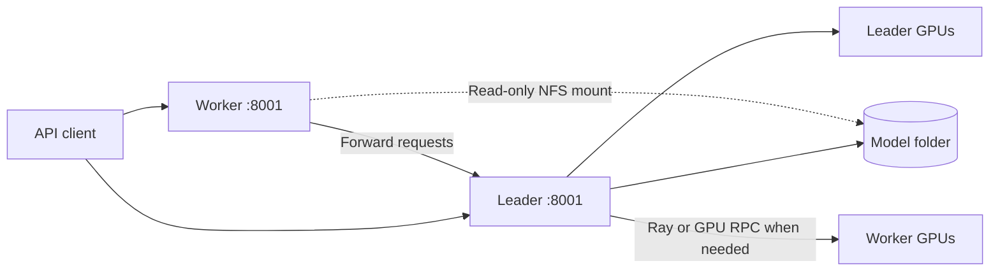
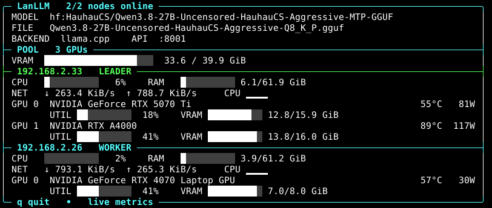
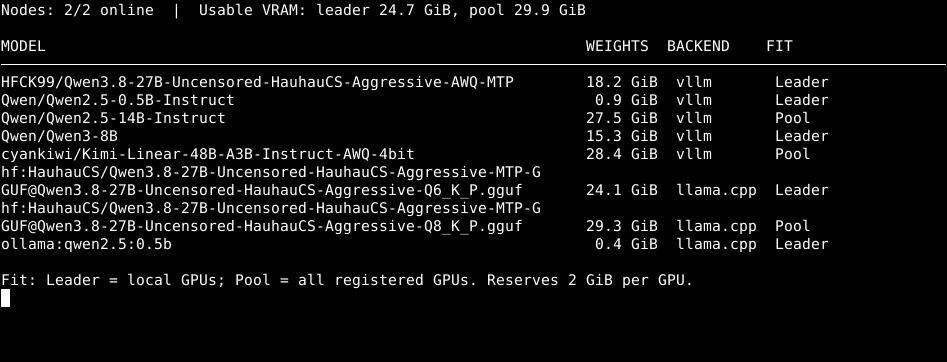
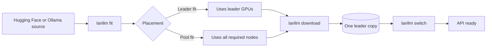
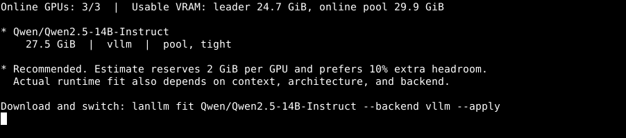

# LanLLM

LanLLM serves models from Hugging Face and the Ollama library on NVIDIA GPUs
connected by a LAN. Each node runs the same container and host command. vLLM
handles supported Hugging Face checkpoints; llama.cpp handles single-file GGUF
models. GPUs contribute memory and compute through pipeline stages or GPU RPC.
Their VRAM is distributed across devices rather than presented as one physical
GPU.

## How the nodes connect



LanLLM elects a leader from the configured nodes. A model that fits the
leader's GPUs can run while a worker is offline. A larger model waits for the
registered pool. The worker's API address forwards requests to the leader
while the worker is online.

## Requirements

Each node needs Docker, the NVIDIA Container Toolkit, a working CDI GPU
specification, and LAN access to the other nodes. Generate the CDI file and
check Docker GPU access:

```bash
sudo nvidia-ctk cdi generate --output=/etc/cdi/nvidia.yaml
docker run --rm --device nvidia.com/gpu=all ubuntu:24.04 nvidia-smi -L
```

`lanllm start` needs passwordless `sudo` for NFS setup. Nodes need TCP access
for NFS on port 2049, the configured API and control ports, and Ray's worker
ports. llama.cpp GPU RPC uses TCP port 50052 by default. The containers use
host networking and privileged mode for the NFS mount.

## Install

Run the installer on each node from a persistent checkout:

```bash
git clone https://github.com/Sergi095/LanLLM.git
cd LanLLM
./install.sh
```

The installer checks Python, Docker Compose, and the NVIDIA driver; creates
`lanllm.conf` and `.env` from their examples if missing; and links the `lanllm`
command into `/usr/local/bin`. It preserves existing configuration and can be
run again after an update. Keep the checkout in place while LanLLM is installed.

## Configure a node

Edit `lanllm.conf` on **each** node before starting the containers:

```bash
${EDITOR:-nano} lanllm.conf
```

This example uses documentation addresses and a placeholder model ID. Replace
them with the LAN addresses and model you intend to serve:

```toml
[cluster]
peers = ["192.0.2.10", "192.0.2.11"]
total_gpus = 3

[models]
directory = "/srv/lanllm-store"
default_id = "owner/repository"

[inference]
max_model_len = 8192
llama_parallel = 1
gpu_memory_utilization = 0.9
layer_partition = "auto"

[api]
port = 8001
control_port = 8501
```

| Setting | Purpose |
| --- | --- |
| `cluster.peers` | Every node's LAN IP, including the current node. Use the same list everywhere. |
| `cluster.total_gpus` | Total GPU count expected when a model needs the pool. Use the same value everywhere. |
| `models.directory` | Local folder created and exported when this node leads. It may differ by node. |
| `models.default_id` | Initial Hugging Face model before a selection is saved. |
| `inference.max_model_len` | Context limit for llama.cpp and the vLLM fallback. |
| `inference.llama_parallel` | Concurrent llama.cpp request slots. Default: `1`; each slot needs context memory. |
| `inference.llama_tensor_split` | Optional llama.cpp GPU weight proportions in device order, such as `"4,4,1"`. Tune when a smaller GPU needs more free memory for prompts. |
| `inference.llama_cache_type_k`, `inference.llama_cache_type_v` | Optional KV cache formats, such as `"q8_0"`, to reduce context memory. |
| `inference.llama_batch_size`, `inference.llama_ubatch_size` | Optional llama.cpp prompt batch limits. Smaller values reduce peak GPU memory use. |
| `inference.gpu_memory_utilization` | GPU memory fraction used for capacity estimates and vLLM. |
| `inference.layer_partition` | `auto` apportions vLLM layers by GPU memory when the pool is needed. |
| `api.port` | OpenAI-compatible API on every node. Default: `8001`. |
| `api.control_port` | Cluster state and model management. Default: `8501`. |

LanLLM places downloads under `models.directory` in `models/` or `gguf/`.
The leader exports one library; workers mount it read-only. The folder is
created by LanLLM, and its location can be changed through the config file.

For a vLLM model that needs special settings, add a profile keyed by its exact
Hugging Face ID:

```toml
[models.profiles."owner/repository"]
max_model_len = 8192
tool_call_parser = "hermes"
served_model_names = ["short-name"]
```

Choose a parser supported by that model. `tool_call_parser` also enables
OpenAI `tool_choice: "auto"` in vLLM. Profiles can set `reasoning_parser`,
`dtype`, `tokenizer`, `layer_partition`, `cpu_offload_gb`, and batching options.
See the [model configuration guide](docs/model-configuration.md) for backend
settings and the [pipeline partitioning guide](docs/pipeline-partitioning.md)
for tuning a model across GPUs.
The `.env` file is available for optional secrets and settings not in the TOML
file; `lanllm.conf` wins when both define the same setting. For gated Hugging
Face repositories, provide `HF_TOKEN` on every node that might become leader.

## Start and use

Start the container on each configured node:

```bash
lanllm start
```

The command works from any directory after installation.

| Command | Result |
| --- | --- |
| `lanllm` | GPU, VRAM, CPU, RAM, and API status across reachable nodes. |
| `lanllm top` | Live terminal dashboard; press `q` to exit. |
| `lanllm top --once` | One dashboard snapshot for scripts. |
| `lanllm nodes` | Registered nodes, capacities, and online state. |
| `lanllm models` | Downloaded models with leader and pool fit estimates. |
| `lanllm delete <ID>` | Remove an unused model from the shared library. |
| `lanllm logs` | Follow the local container logs. |
| `lanllm stop` | Stop the local container. |

The live dashboard shows utilization and memory use for every reachable GPU:



The model catalog shows which downloads fit on the leader and which require
the GPU pool:



`nvidia-smi` lists only the GPUs physically attached to its host. LanLLM's
commands show the network pool. The node registry retains the last known
capacity of offline workers.

## Find and download a model



Start with `lanllm fit` to inspect weight variants in a source. It reserves
2 GiB per GPU for runtime and prefers a further 10% headroom. A fit estimate
cannot guarantee that a model architecture or context size will run.

```bash
lanllm fit owner/repository
lanllm fit owner/gguf-repository --backend llama.cpp
lanllm fit owner/gguf-repository --backend llama.cpp --file model.Q8_K.gguf
lanllm fit ollama:model:tag
```



The recommendation favors headroom and may select a variant that fits the
leader alone. To use the worker GPUs, inspect a larger variant with `--file`;
its result must say `pool`. A `pool, tight` result needs a real loading test
because the memory estimate does not account for every runtime allocation.

Download a chosen source on either node. The leader stores the files once:

```bash
lanllm download owner/repository
lanllm download owner/gguf-repository --backend llama.cpp --file model.Q6_K.gguf
lanllm download owner/gguf-repository --backend llama.cpp --file model.Q8_K.gguf
lanllm download ollama:model:tag
lanllm download
```

The final command follows an existing download. A plain Hugging Face ID or
`https://huggingface.co/owner/repository` URL selects vLLM. For GGUF, specify
`--backend llama.cpp`; add `--file` if the repository contains multiple GGUF
files. An `ollama:model:tag` name or Ollama library URL selects llama.cpp.
The Ollama path supports one GGUF weight layer; models requiring a projector
or other extra weights are rejected.

Downloading leaves the current model running. Use the reference printed at
completion or shown by `lanllm models` to select it:

```bash
lanllm switch owner/repository
lanllm switch 'hf:owner/gguf-repository@model.Q6_K.gguf'
lanllm switch ollama:model:tag
```

`lanllm switch` waits until the selected model appears on every required API
address. A leader-fit model can start without a worker; a pool-fit model waits
for all configured GPUs. `lanllm fit owner/repository --apply` combines
inspection, download, and switch for the recommended variant. A model beyond
the online capacity is rejected before download.

## Delete a model

Copy the exact reference from `lanllm models` and run the command on any node:

```bash
lanllm delete 'hf:owner/gguf-repository@model.Q6_K.gguf'
lanllm delete owner/repository
```

The leader removes the model's weights and ready marker from the shared
library. LanLLM refuses to delete the active model; switch to another model
first. `lanllm model delete <ID>` is an equivalent command.

## Call the API

Both online nodes expose the same OpenAI-compatible API:

```text
http://<node-a-lan-ip>:8001/v1
http://<node-b-lan-ip>:8001/v1
```

The active model and its context limit are available at `/v1/models`. The
response exposes the allocated context as `meta.n_ctx` for clients that
discover local model limits. Tool definitions and system prompts count toward
that limit.

Clients can use the stable model name `lanllm` for the currently selected
model. The original model ID remains accepted, so clients using a specific
model name continue to work after this change.

```bash
curl http://<node-lan-ip>:8001/v1/models
```

Only one service can bind the configured API port on a host. Change `api.port`
on every node if another process already uses it.

## Existing caches and advanced settings

A Hugging Face Hub snapshot on the same filesystem can be hardlinked into the
shared library without duplicating its disk blocks:

```bash
cd /path/to/LanLLM
sudo python3 -m lanllm.import_cache owner/repository SNAPSHOT_REVISION \
  --cache /path/to/huggingface/hub --store /path/to/lanllm-store
```

For vLLM, `layer_partition = "auto"` allocates model layers according to the
memory visible on each GPU when the pool is used. A manual partition contains
one layer count per GPU, and the counts must sum to the model's hidden layers.
`trust_remote_code = true` executes repository code; set it only for a trusted
source. Ray's network services and llama.cpp GPU RPC are intended for a trusted
LAN.

## Remove LanLLM

Run `lanllm stop` and `lanllm uninstall` on every node. Uninstall removes the
container, image, NFS export, command link, project cache, and checkout. It
removes a model directory only when LanLLM created that dedicated directory;
existing model files outside it remain. Preview with
`lanllm uninstall --dry-run`, or keep the checkout with
`lanllm uninstall --keep-source`.

LanLLM uses [vLLM's container image](https://docs.vllm.ai/en/latest/deployment/docker/),
[Ray for multi-node execution](https://docs.ray.io/en/latest/cluster/vms/user-guides/launching-clusters/on-premises.html),
and [llama.cpp GPU RPC](https://github.com/ggml-org/llama.cpp/blob/master/tools/rpc/README.md).
